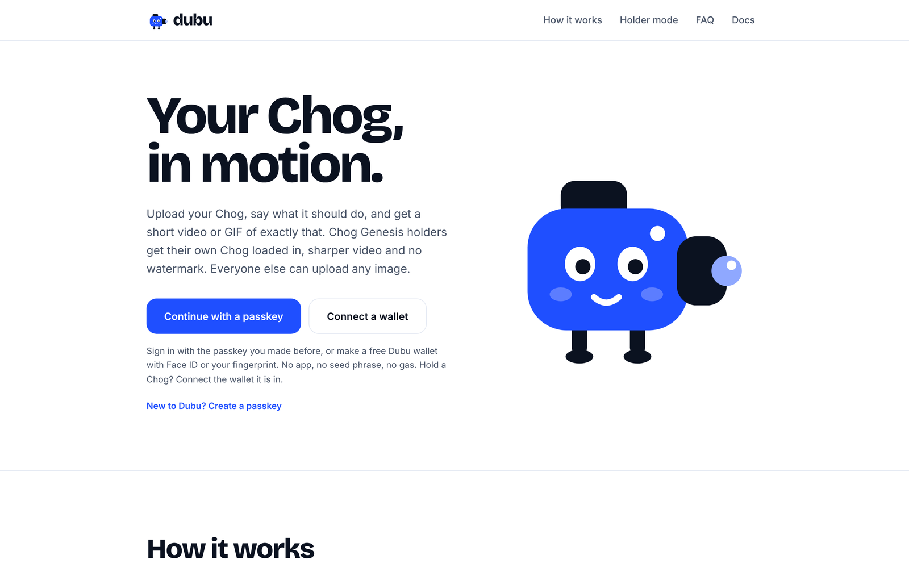
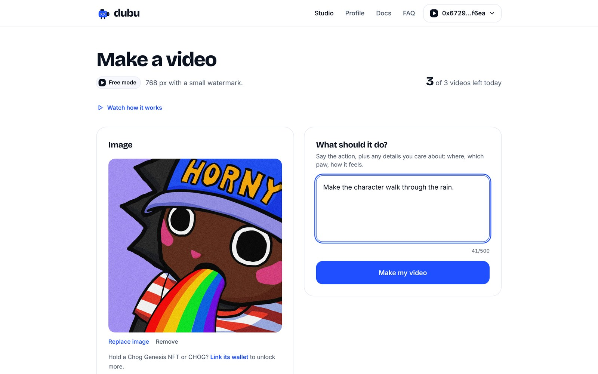
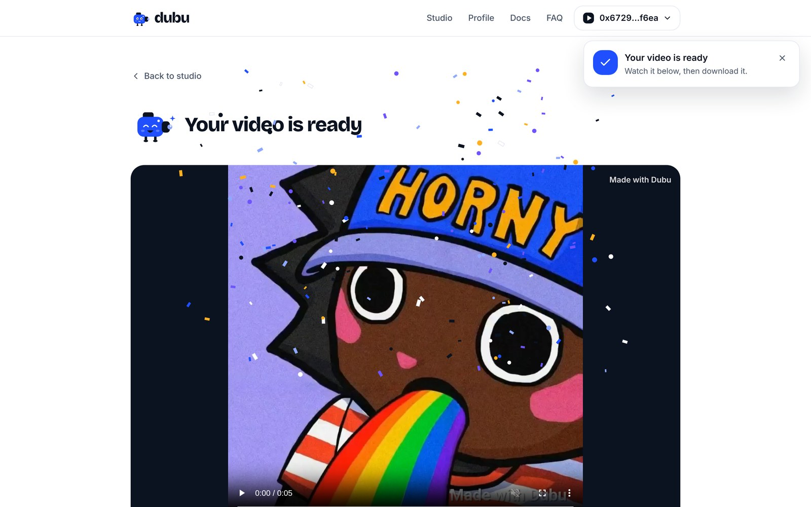
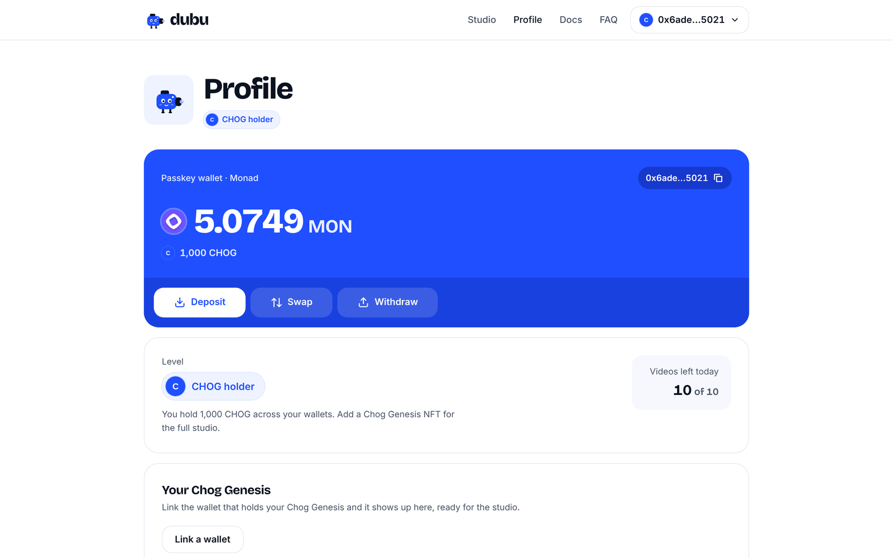
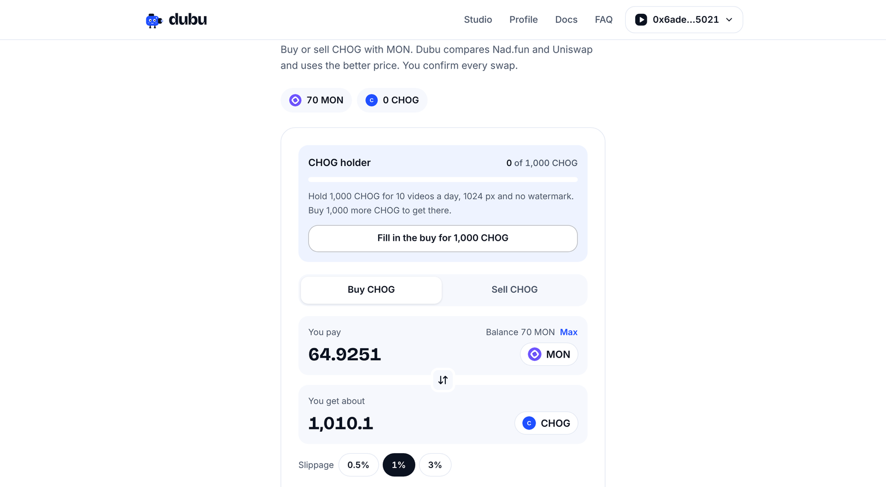
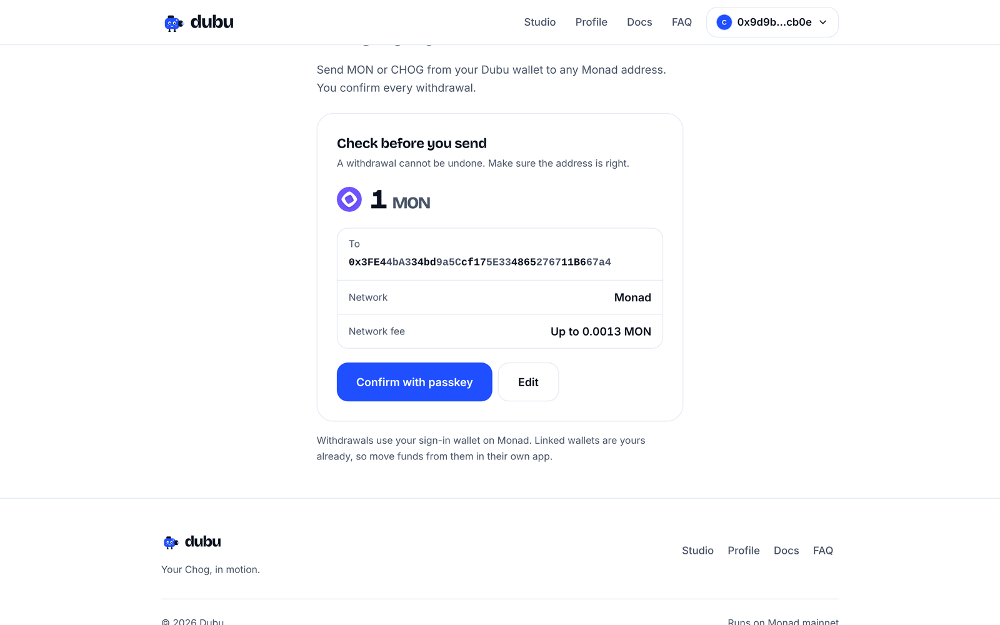

# Dubu

**Your Chog, in motion.** Upload your Chog Genesis NFT, or any image, say what it should do, and get a short video or GIF of exactly that. Built on Monad.

**Live:** [dubuai.vercel.app](https://dubuai.vercel.app) · **Docs:** [dubuai.vercel.app/docs](https://dubuai.vercel.app/docs)



## Screens

| Studio | Result |
| --- | --- |
|  |  |
| **Profile** | **Swap** |
|  |  |
| **Withdraw** | |
|  | |

Screens from the current build.

## What it does

- **Image to video.** One image and one sentence give a clip of about 5 seconds. Download it as a video or a GIF.
- **Holder mode.** Chog Genesis holders get their own Chog loaded in, with its traits worked into the shot, sharper video, no watermark and more videos a day.
- **Your words, followed.** A deterministic caption reader turns your sentence into the shot: the action, the setting, the effects and the camera you asked for, with your words kept as written and nothing invented. An optional director model can write a fuller shot; any shot that drops your action is thrown out.
- **Passkey wallets.** Sign in with Face ID or a fingerprint. No app, no seed phrase, no gas. Or connect any EVM wallet that supports Monad.
- **Linked wallets.** Keep your Chog in a cold wallet and link it. Dubu counts everything your linked wallets hold.
- **Swap, the way up.** Buy and sell CHOG with MON without leaving Dubu. Dubu quotes Nad.fun and Uniswap and uses the better price. On the free level, Swap shows how much CHOG you hold toward CHOG holder and fills in the exact buy that gets you there. Every swap is one confirmation, and your level changes the moment the CHOG lands.
- **Withdraw.** Send MON or CHOG from your Dubu wallet to any Monad address, with one confirmation.
- **Deposit and notifications.** A deposit page with a QR code, and alerts for deposits, swaps and finished videos.

## Levels

| Level | Unlocks with | Videos a day | Video | Watermark |
| --- | --- | --- | --- | --- |
| Genesis holder | A Chog Genesis NFT in any linked wallet | 50 | Up to 1024 px, own Chog | No |
| CHOG holder | `CHOG_TOKEN_MIN` CHOG across linked wallets | 10 | Up to 1024 px, any image | No |
| Free | Signing in | 3 | Up to 768 px, any image | Yes |

Limits are settings. The level is checked onchain on every video, and the browser never decides it.

## How a video is made

1. The studio sends the image and the sentence. Holders pick a Chog; the server loads its art and traits itself.
2. The server re-checks the level, reserves one video from the daily quota and applies the burst limits.
3. The caption reader turns the sentence into the shot, keeping the user's words as written. If the director is on, it may write a fuller shot and screen uploads; a shot without the requested action is replaced by the reader's version, and a refused image gives the video back.
4. [deAPI](https://deapi.ai) renders it with LTX-2.3 (22B distilled, 8 steps, 121 frames at 24 fps), at a preset size that matches the image's shape. If the model is refused, it falls back to LTX-Video 13B.
5. The browser polls a signed job token and plays the video through Dubu, never from the provider directly.
6. Free downloads get the watermark burned in, in the browser. GIFs are made in the browser too.

## Stack

Next.js 15 (App Router) · React 19 · TypeScript · Tailwind CSS 4 · TanStack Query · wagmi, viem and RainbowKit · [Mera](https://github.com/category-labs/mera) passkey wallets · Monad · Nad.fun · Uniswap v3 · deAPI with LTX Video · Upstash Redis · Vercel

## Run it locally

```bash
npm install
cp .env.example .env.local   # fill in what you need
npm run dev
```

With no video key, Dubu runs in demo mode and returns a sample clip after a few seconds. `/api/health` shows what is configured.

## Configuration

Every value lives in the environment. `.env.example` lists them all with notes.

| Area | Variables |
| --- | --- |
| Chain | `NEXT_PUBLIC_MONAD_NETWORK` (mainnet or testnet), `MONAD_RPC_URL` |
| Sessions | `SESSION_SECRET`, 32+ characters, required in production |
| Wallets | `NEXT_PUBLIC_WC_PROJECT_ID` for WalletConnect |
| Chog Genesis | `CHOG_CONTRACT_ADDRESS`, `ALCHEMY_API_KEY` (lists a wallet's Chogs), `IPFS_GATEWAY` |
| CHOG token | `CHOG_TOKEN_ADDRESS`, `CHOG_TOKEN_MIN` (empty keeps the CHOG holder level off) |
| Video | `DEAPI_API_KEY`, `VIDEO_MODEL` |
| Director | `DIRECTOR_API_KEY`, `DIRECTOR_MODEL` |
| Storage | `KV_REST_API_URL`, `KV_REST_API_TOKEN` (set by the Upstash integration on Vercel) |
| Limits | `HOLDER_DAILY_LIMIT`, `TOKEN_DAILY_LIMIT`, `FREE_DAILY_LIMIT`, `FREE_IP_DAILY_LIMIT` |
| Withdraw | `WITHDRAW_ENABLED` (on unless set to `false`) |
| Swap | `SWAP_ENABLED`, `SWAP_CANARY_ADDRESSES`, `SWAP_MIN_MON`, `SWAP_MAX_MON`, `SWAP_MIN_CHOG`, `SWAP_MAX_CHOG`, `WMON_ADDRESS`, `NADFUN_LENS`, `NADFUN_BONDING_ROUTER`, `NADFUN_DEX_ROUTER`, `UNISWAP_V3_ROUTER`, `UNISWAP_V3_QUOTER` |
| Landing | `SHOWCASE_CHOG_IDS`, `CHOG_TOKEN_LOGO_URL` |

## Security

- **No custody.** A passkey wallet's key is derived on the device from the passkey's PRF output, used for one signature, then wiped. Dubu never stores or receives it. Users can export the recovery phrase from Profile.
- **Sessions.** Signing in is a signed message, checked on the server (EOAs and smart wallets). The session is an httpOnly, signed cookie.
- **Levels.** Ownership and balances are read onchain on every video. A saved Chog is re-checked with `ownerOf` on every read, so a sold Chog drops off.
- **Linked wallets.** Each link is proved by a signature from that wallet, and a wallet can belong to one account at a time.
- **Swaps.** The server builds every call with the user as the only recipient. Before anything is broadcast, it decodes the call again and refuses anything else: only the configured routers, CHOG in or out, a real minimum, and no MON attached to approvals or sales. A Nad.fun sale carries a permit for exactly the amount being sold, so it is one transaction; other sales approve exactly that amount first. A signed swap is never signed twice: a slow confirmation is followed by its hash, and the same signed transaction sent twice is one transaction.
- **Withdrawals.** A signed withdrawal is broadcast only if it is a plain MON send or a CHOG `transfer` from the signed-in wallet. The zero address, the wallet itself and every configured token or router contract are refused as recipients. The same signed transaction sent twice is one transaction.
- **Limits.** Daily quotas per account, a daily cap on free videos per network, burst limits on generation, and rate limits on sign-in, quotes, swaps, images and account reads. Generation fails closed if Redis is down; sign-in fails open.
- **Headers.** The site cannot be framed by another site, and content types are enforced.

## Project layout

```
app/            pages (landing, studio, result, profile, deposit, swap, withdraw, docs, faq) and API routes
components/     UI: studio, sign-in, swap, header, notifications, Chog frames
lib/            server and shared logic
  chog.ts       Chog Genesis ownership, metadata and images
  standing.ts   levels across linked wallets
  interpret.ts  the deterministic caption reader
  director.ts   the optional shot writer and upload screening
  video.ts      deAPI jobs and fallbacks
  swap.ts       quotes, call building and the swap guard
  withdraw.ts   transfers out and the withdrawal guard
  passkey.ts    passkey wallets on the device
  limits.ts     quotas and rate limits
scripts/        end-to-end checks against a running server
```

## Checks

```bash
npm run typecheck
npm run build
SESSION_SECRET=$(openssl rand -hex 32) npm start
npm run smoke        # in another terminal, demo mode
```

`scripts/` also holds checks for levels, linked wallets, the free-video network cap, a real provider run, and jobs and quotas across two server instances.

## Notes

- Passkeys are bound to the site's domain. Moving domains means existing passkeys stop working there, so plan any move before users rely on them.
- The Chog Genesis contract cannot list a wallet's tokens onchain. Without `ALCHEMY_API_KEY`, holders add their Chog once by its number.
